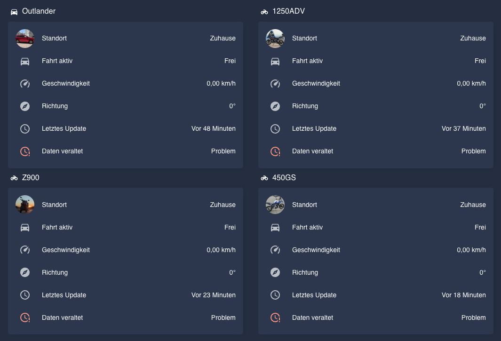
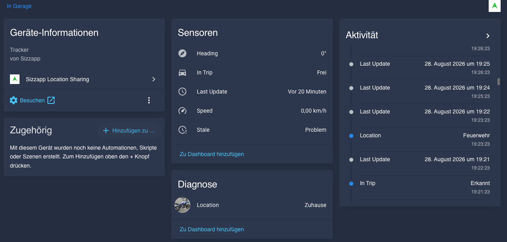

# Sizzapp Location Sharing for Home Assistant

Custom integration for [Home Assistant](https://www.home-assistant.io/) that pulls real-time location and status data from [Sizzapp](https://www.sizzapp.com/) GPS trackers via the public sharing API.

**No Sizzapp account credentials required — just a sharing link or code.** Each tracker becomes a device on your map with its own sensors, so you can build automations around where your vehicles are and whether they are moving.

## ✨ Features

- 🛰️ **GPS device tracker** — live position on the Home Assistant map
- 🖼️ **Vehicle image** — the picture from the Sizzapp app shows up as the entity picture
- 🚗 **Trip detection** — a binary sensor tells you when the vehicle is moving
- 🏎️ **Speed & heading** — current speed (km/h or mph) and direction of travel
- 🕒 **Last-update timestamp** — as a first-class sensor, great for "hasn't reported in X minutes" automations
- 💤 **Stale detection** — a binary sensor that turns on when a tracker goes quiet
- 🔀 **Multiple trackers** — add one instance per share link; each gets its own device
- 🔒 **Privacy-first** — uses only the public sharing API; the share code is never written to logs or persisted in clear text, and coordinate precision is configurable

## 📸 Screenshots

**Every tracker as its own device, with live sensors and the vehicle image:**

**Device detail — device info, sensors and an activity timeline:**

## 📋 Requirements

- Home Assistant **2026.3** or newer
- Home Assistant **2026.11+**: nothing else — the store is built in as the **Marketplace**. Older versions: [HACS](https://hacs.xyz/) installed
- A Sizzapp sharing link or shared code (created in the Sizzapp app)

## 📥 Installation

### Via Marketplace / HACS (recommended)

1. Click the button above, **or** open **Settings → Marketplace** (HA 2026.11+) / **HACS** (older versions) and search for **Sizzapp Location Sharing**.
2. Install the integration and restart Home Assistant.
3. Go to **Settings → Devices & Services → Add Integration** and search for **Sizzapp Location Sharing**.

### Upgrading from the old `sizzapp` domain (v1.2.x and older)

Up to v1.2.x the integration used the domain `sizzapp`; since v1.3.0 it is `sizzapp_tracker`. Home Assistant cannot move a config entry between domains, so each share code has to be added once more — your existing devices, entities, history and automations are taken over automatically:

1. Install **Sizzapp Location Sharing** v1.3.0 or newer and restart Home Assistant.
2. Under **Settings → Devices & Services**, **disable** every old **Sizzapp** entry (domain `sizzapp`). Do not delete them yet. This step matters: Home Assistant can only take over entities that are not currently loaded — otherwise you get duplicates with a `_2` suffix.
3. **Add Integration → Sizzapp Location Sharing** and enter the same share code (or URL) as before, once per old entry.
4. Check that the entities still have their old entity IDs and now belong to the new integration. Then delete the old, now empty `sizzapp` entries and remove the folder `config/custom_components/sizzapp`.

### Manual

Copy the `custom_components/sizzapp_tracker` folder into your Home Assistant `config/custom_components/` directory and restart.

## ⚙️ Configuration

1. In the Sizzapp app on your phone, create a tracking/sharing link (or copy an existing one).
2. In Home Assistant, add the integration and paste the full share URL **or** just the sharing code — both work.
3. Done! The tracker appears as a device with its entities.

### Options

After setup, open the integration's **Configure** dialog to adjust:

- **Poll interval** — how often to fetch new data (default: 60 s, minimum: 30 s)
- **Speed unit** — km/h or mph
- **Coordinate precision** — decimal places for GPS coordinates (0–6, default: 6). Lowering this is a simple privacy measure if you share your dashboard.
- **Stale threshold** — minutes without a tracker update before the **Stale** sensor turns on (default: 5)

All options take effect immediately — no restart needed.

## 🧩 Entities

Each configured tracker creates one device with the following entities:

| Entity | Type | Description |
|---|---|---|
| **Location** | `device_tracker` | GPS position on the HA map, with the vehicle image from Sizzapp |
| **Speed** | `sensor` | Current speed (km/h or mph, configurable) |
| **Heading** | `sensor` | Direction of travel in degrees |
| **Last Update** | `sensor` | Timestamp of the last tracker report |
| **In Trip** | `binary_sensor` | Whether the vehicle is currently moving |
| **Stale** | `binary_sensor` | Turns on when the tracker hasn't reported in for a while |

## 🔁 Multiple trackers

Add one integration instance per share link — each creates its own device. Tested with several Sizzapp trackers at once.

## 🩺 Troubleshooting

- **"Cannot connect" / "not found" when adding** — double-check the share link or code. Both the full URL (`https://sizzapp.com/location/<code>`) and the bare code are accepted.
- **Location shows as unavailable** — the tracker may not have reported a fix yet; the **Last Update** and **Stale** sensors show how recent the data is.
- **No icon in the Marketplace / HACS store panel** — this is a known store-frontend limitation with in-tree brand images on HA 2026.3+; the icon still renders correctly inside Home Assistant itself.

## 📝 Notes

- This integration uses the **public sharing API** only. It does not require your Sizzapp account credentials.
- The sharing API provides location, speed, heading, trip status and the vehicle image. Battery voltage, eco-drive scores and other advanced data from the Sizzapp app are not available through this API.

## ❤️ Support

If this integration is useful to you, you can support development here:

Bug reports and feature requests are welcome via [GitHub Issues](https://github.com/Artaiios/ha_sizzapp/issues).

## 🔗 Links

- [Sizzapp Website](https://www.sizzapp.com/)
- [Changelog](CHANGELOG.md)

---

*This is an unofficial, community-developed integration and is not affiliated with Sizzapp.*
